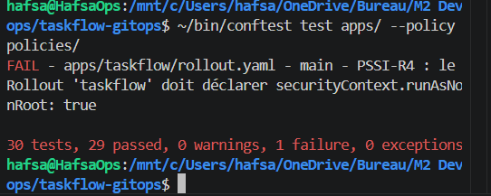
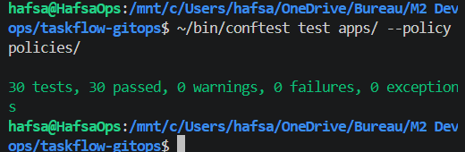
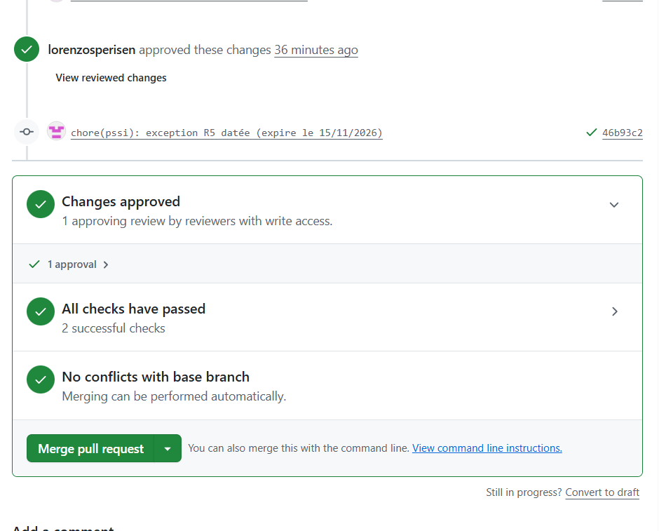
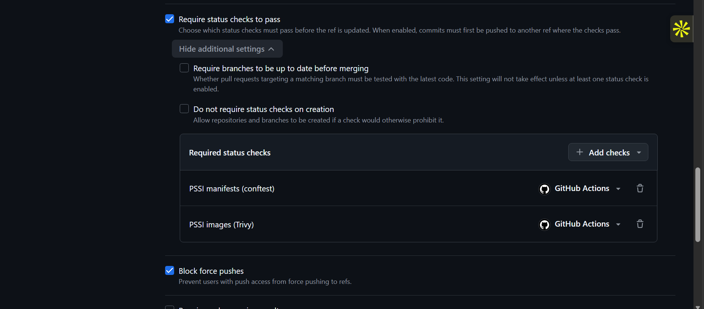
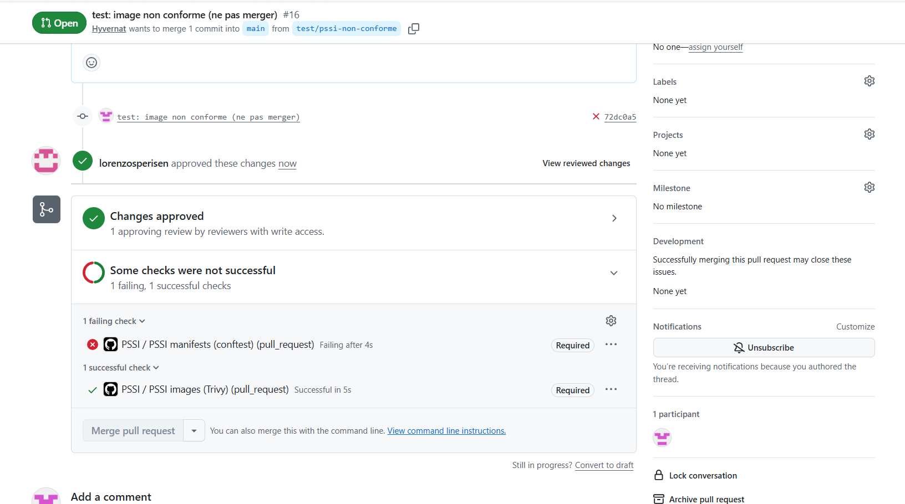
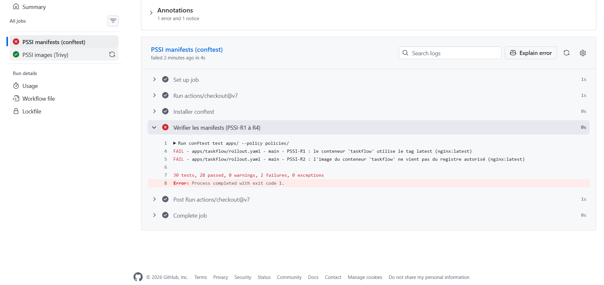

# taskflow-gitops — dépôt GitOps du cours CI/CD M2

Ce dépôt décrit **l'état voulu** de l'application TaskFlow dans Kubernetes.
Argo CD le surveille et aligne le cluster dessus : pour changer la production,
on ne tape pas de commande, on fait une **Pull Request**.

## Installation (à faire chez vous, avant le cours)

Prérequis : Docker Desktop démarré, 8 Go de RAM, 10 Go de disque libre.
Sous Windows : WSL2 (Ubuntu) + intégration WSL de Docker Desktop, et toutes les commandes dans WSL.

```bash
git clone https://github.com/9m7fjfpv9k-cyber/taskflow-gitops.git
cd taskflow-gitops
./scripts/install.sh
```

Le script crée un cluster local `kind`, installe Argo CD et Argo Rollouts,
puis télécharge les images des labs. Comptez 5 à 15 minutes.
Il peut être relancé sans risque.

## Structure

| Chemin                    | Rôle                                                            |
| ------------------------- | --------------------------------------------------------------- |
| `apps/taskflow/`          | Les manifests surveillés par Argo CD                            |
| `argocd/application.yaml` | Déclare l'application dans Argo CD                              |
| `exemples/bluegreen/`     | Manifests pour le déploiement Blue-Green                        |
| `exemples/canary/`        | Manifests pour le déploiement Canary                            |
| `exemples/robustesse/`    | Canary avec test de charge k6 automatique, modèle de postmortem |
| `exemples/ci/`            | Pipelines de la mini-PSSI (GitHub Actions et GitLab CI)         |
| `policies/`               | Mini-PSSI et règles Rego vérifiées par conftest                 |
| `scripts/install.sh`      | Installation de l'environnement                                 |
| `scripts/argocd-ui.sh`    | Ouvre l'interface d'Argo CD                                     |
| `scripts/observe.sh`      | Montre quelle version répond, et avec quel code HTTP            |
| `scripts/charge.sh`       | Lance à la main le test de charge k6 contre un service          |

## Images disponibles

`ghcr.io/9m7fjfpv9k-cyber/taskflow` en versions `1.0.0`, `1.1.0`, `2.0.0`, `2.1.0` et `2.2.0`.

## Équipe

<!-- Noms du binôme -->

- Hafsa HYVERNAT
- Lorenzo SPERISEN
- Lina Mebouga Messia

## Journal des déploiements — Lab GitOps TaskFlow

**Date :** 14 octobre 2026  
**Dépôt :** [lorenzosperisen/taskflow-gitops](https://github.com/lorenzosperisen/taskflow-gitops)  
**Environnement :** Docker Desktop, WSL2 Ubuntu, Kubernetes kind, Argo CD v3.5.3  
**Branche surveillée :** `main`  
**Application :** `taskflow`  
**Namespace :** `taskflow`

### 1. Objectif du lab

L'objectif est de mettre en pratique une démarche GitOps en utilisant GitHub, Kubernetes et Argo CD

Nous devons démontrer qu'il est possible de:

- Déployer une nouvelle version de TaskFlow à partir d'une Pull Request
- Observer le délai entre la fusion de la PR et le déploiement
- Provoquer volontairement des dérives dans Kubernetes
- Vérifier qu'Argo CD restaure automatiquement l'état défini dans Git
- Effectuer un retour arrière contrôlé avec `git revert`

### 2. Installation et état initial

Nous avons créé un fork du dépôt `taskflow-gitops` et configuré une règle de protection sur la branche `main`avec une approbation obligatoire avant fusion.

Chaque membre du groupe utilise son propre cluster Kubernetes local.

L'installation a été réalisée avec :

```bash
bash scripts/install.sh
```

Le contexte Kubernetes utilisé est :

```text
kind-cicd
```

L'application Argo CD a été configurée pour surveiller notre fork GitHub, sur la branche `main`, dans le dossier `apps/taskflow`.


La commande `bash scripts/observe.sh` a confirmé que l'application répondait correctement en version `1.0.0`.

### 3. Déploiement de TaskFlow 2.0.0 par Pull Request

Nous avons créé une branche `feat/taskflow-v2` pour modifier le fichier `apps/taskflow/deployment.yaml`.

La modification consistait uniquement à remplacer l'image Docker :

```diff
- image: ghcr.io/9m7fjfpv9k-cyber/taskflow:1.0.0
+ image: ghcr.io/9m7fjfpv9k-cyber/taskflow:2.0.0
```

La modification a été enregistrée dans un commit, puis proposée dans la [Pull Request #1 — Deploy TaskFlow v2.0.0](https://github.com/lorenzosperisen/taskflow-gitops/pull/1).

Après la fusion, Argo CD a détecté la nouvelle configuration et a effectué le déploiement automatiquement.

**États observés :**

```text
Synced / Healthy
OutOfSync / Healthy
Synced / Progressing
Synced / Healthy
```

**Résultat final :**


La nouvelle version a été déployée sans utiliser `kubectl set image` pour effectuer le changement.

### 4. Mesure du délai de déploiement

L'heure de création du ReplicaSet a été récupérée avec :

```bash
kubectl -n taskflow get replicasets -l app=taskflow -o custom-columns='NAME:.metadata.name,CREATED:.metadata.creationTimestamp,READY:.status.readyReplicas,IMAGE:.spec.template.spec.containers[0].image'
```

**Interprétation :** environ 2 minutes et 42 secondes se sont écoulées entre l'heure de fusion affichée par GitHub et la création du ReplicaSet de la nouvelle version.


### 5. Test de dérive : nombre de réplicas

L'état souhaité dans Git prévoyait 4 réplicas.

Nous avons volontairement modifié Kubernetes :

```bash
kubectl -n taskflow scale deployment/taskflow --replicas=2
```

La commande a retourné :

```text
deployment.apps/taskflow scaled
```

Lors de la vérification suivante, le Deployment affichait :


**Observation :** le cluster est revenu à 4 réplicas, conformément au fichier Git.

Cette expérience illustre l'auto-réparation d'Argo CD grâce au paramètre `selfHeal: true`.

### 6. Test de dérive : image Docker

Alors que Git demandait la version `2.0.0`, nous avons tenté de remplacer manuellement l'image du Deployment par `1.0.0`.

Commande exécutée :

```bash
kubectl -n taskflow set image deployment/taskflow taskflow=ghcr.io/9m7fjfpv9k-cyber/taskflow:1.0.0
```

Kubernetes a confirmé :

```text
deployment.apps/taskflow image updated
```

Nous avons ensuite vérifié l'image réellement déclarée dans le Deployment :

```bash
kubectl -n taskflow get deployment taskflow -o jsonpath='{.spec.template.spec.containers[0].image}{"\n"}'
```

Résultat :


**Observation :** Argo CD a restauré la version `2.0.0` qui correspondait toujours à l'état souhaité dans Git.

Les deux tests de dérive montrent qu'une modification manuelle de Kubernetes ne remplace pas durablement la configuration déclarée dans le dépôt.

### 7. Retour arrière avec Git Revert

Pour revenir à la version initiale, nous avons utilisé le bouton **Revert** de la PR #1 sur GitHub.

Une nouvelle Pull Request a été créée :

[Pull Request #3 — Revert "Deploy TaskFlow v2.0.0"](https://github.com/lorenzosperisen/taskflow-gitops/pull/3)

La PR a été approuvée par `Hyvernat`, puis fusionnée dans `main`.

Le changement inverse était :

```diff
- image: ghcr.io/9m7fjfpv9k-cyber/taskflow:2.0.0
+ image: ghcr.io/9m7fjfpv9k-cyber/taskflow:1.0.0
```

Immédiatement après la fusion, la version `2.0.0` était encore observée. Après le délai de réconciliation d'Argo CD et la mise à jour Kubernetes, la version `1.0.0` était de nouveau disponible.


Le retour arrière a donc réussi sans modification manuelle du Deployment Kubernetes.

### 8. Réponses aux questions du professeur

**Question 1 — Push ou pull ?**

Le modèle utilisé est **GitOps pull**.

Les développeurs proposent leurs modifications sur GitHub à travers des Pull Requests

**Question 2 — Qui a corrigé quoi ?**

Les membres du groupe ont modifié et validé les configurations Git à travers des commits et des Pull Requests.

Argo CD a corrigé automatiquement les dérives constatées dans Kubernetes :

- Retour de 2 à 4 réplicas après `kubectl scale`.
- Retour de l'image `1.0.0` à `2.0.0` après `kubectl set image`.

Kubernetes a assuré l'exécution et le remplacement des pods.

Lors du Revert le changement a été effectué dans Git puis Argo CD a appliqué la nouvelle configuration pour revenir à `1.0.0`.

**Question 3 — Pourquoi `git revert` ?**

`git revert` permet d'annuler les effets d'un commit précédent en créant un nouveau commit inverse sans supprimer l'historique

Cette approche est adaptée au GitOps pour plusieurs raisons :

- Elle conserve la traçabilité des modifications et des retours arrière
- Elle permet une revue et une approbation par Pull Request
- Elle respecte les règles de protection de la branche `main`
- Elle permet à Argo CD de détecter et d'appliquer le retour arrière comme n'importe quel autre changement Git

Contrairement à une modification manuelle avec `kubectl` le Revert met à jour la source de vérité.

### 9. Conclusion

Ce lab nous a permis de comprendre le fonctionnement d'un déploiement GitOps avec Argo CD.

Nous avons réussi à déployer TaskFlow `2.0.0` à partir d'une PR, à observer la correction automatique de deux dérives Kubernetes puis à revenir à la version `1.0.0` grâce à une nouvelle PR de Revert.

L'expérience montre que Git constitue la source de vérité de l'infrastructure déclarative tandis qu'Argo CD assure la réconciliation entre l'état souhaité et l'état réel du cluster


## Mini-PSSI : quality gates (Lab C)

Une règle de sécurité n'existe que si un pipeline la vérifie. Les 5 règles de `policies/pssi.md` sont vérifiées automatiquement sur chaque PR par `.github/workflows/pssi.yml`.
Les deux checks sont **obligatoires** dans le ruleset de `main` : une PR non conforme ne peut pas être mergée, même approuvée.

| Règle | Exigence | Contrôle | Outil | Preuve |
| --- | --- | --- | --- | --- |
| R1 | Tag explicite, jamais `latest` | `deny` si l'image finit par `:latest` ou n'a pas de tag | conftest (Rego) | PR #16 bloquée : `nginx:latest` |
| R2 | Images du registre `ghcr.io/9m7fjfpv9k-cyber/` uniquement | `deny` si l'image ne commence pas par ce registre | conftest (Rego) | PR #16 bloquée : `nginx` |
| R3 | Limite mémoire sur chaque conteneur | `deny` si `resources.limits.memory` est absent | conftest (Rego), écrite par l'équipe | Rollout conforme (`256Mi`) |
| R4 | Pods jamais en root | `deny` si `securityContext.runAsNonRoot` n'est pas `true` | conftest (Rego), écrite par l'équipe | FAIL R4 puis correction du Rollout (PR #14) |
| R5 | Aucune faille HIGH/CRITICAL corrigeable dans les images | scan des images déployées dans `apps/` | Trivy 0.75.0 | Exception datée dans `.trivyignore` (PR #14) |

### R4 : le cercle complet (règle → rouge → correction → vert)

Après l'ajout de R3 et R4, conftest refuse notre Rollout, qui ne déclarait pas `runAsNonRoot` :



Correction dans `apps/taskflow/rollout.yaml` (`securityContext.runAsNonRoot: true`). C'est sans risque, car l'image tourne déjà avec l'utilisateur non-root `10001`. Résultat : 30 tests, 30 passed.



### R5 : exception datée pour l'image du formateur

Trivy a trouvé 9 CVE HIGH (aucune CRITICAL) dans l'image `taskflow:2.2.0` : 3 dans `starlette` 0.41.3 et 6 dans `urllib3` 1.26.20. L'image est fournie par le formateur, nous ne pouvons pas la reconstruire. La PSSI autorise alors une exception **écrite, justifiée, datée et validée en PR** : voir `.trivyignore`.

- Chaque CVE porte `exp:2026-11-15` : après cette date, Trivy redevient rouge automatiquement et l'exception doit être revue.
- Risque accepté : surtout des dénis de service et des fuites via redirections HTTP, limités car l'API tourne dans un cluster kind local non exposé.



### Les checks sont obligatoires



### Preuve du blocage : PR #16 non conforme

PR de test avec `image: nginx:latest`. Même approuvée, elle ne peut pas être mergée : « PSSI manifests (conftest) » échoue sur R1 et R2.





La PR a été fermée sans merge.

### Pourquoi c'est utile

- **Retour rapide :** l'erreur est vue dans la PR, avant le déploiement.
- **En entreprise,** on ajouterait Kyverno ou Gatekeeper dans le cluster, pour bloquer aussi ce qui contourne le pipeline (un `kubectl apply` manuel).
- **Une exception sans date** devient une faille permanente oubliée. Avec `exp:`, elle est revue de force.

**Exceptions en cours :** 9 CVE dans `.trivyignore`, expiration le 15/11/2026.
