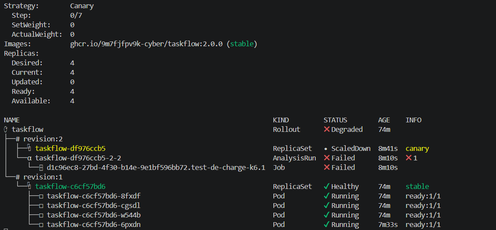
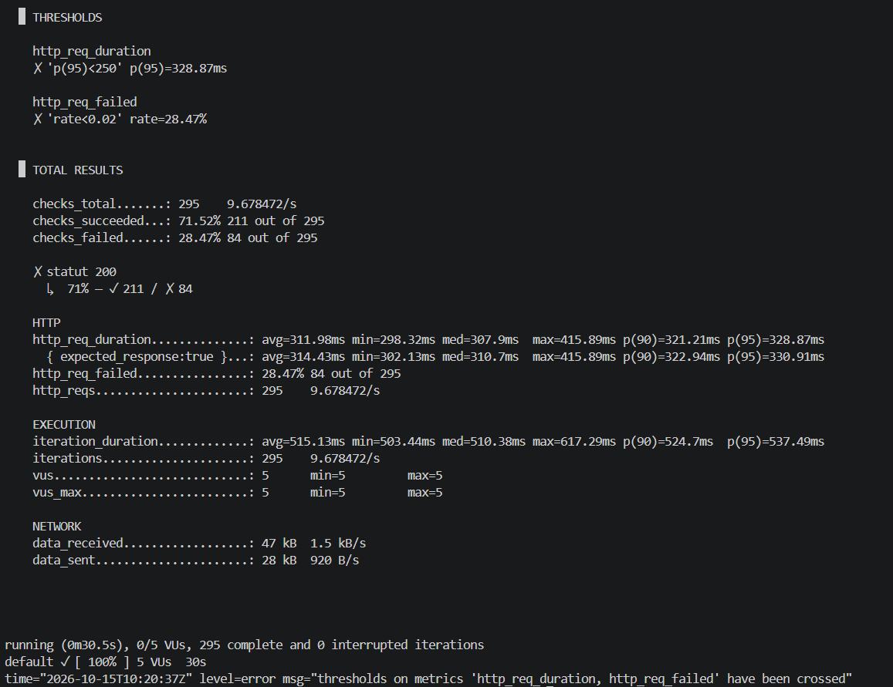
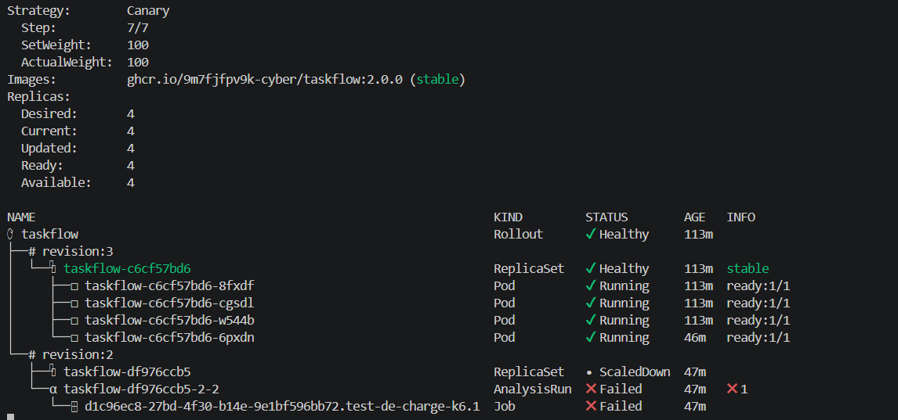
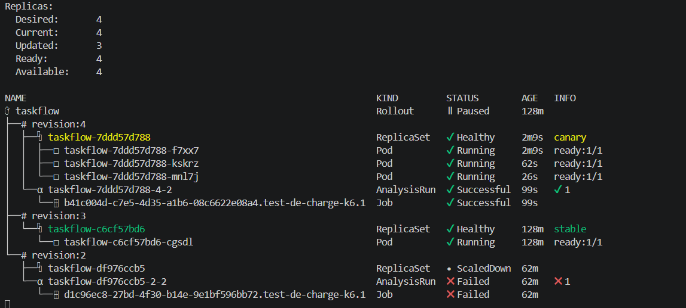
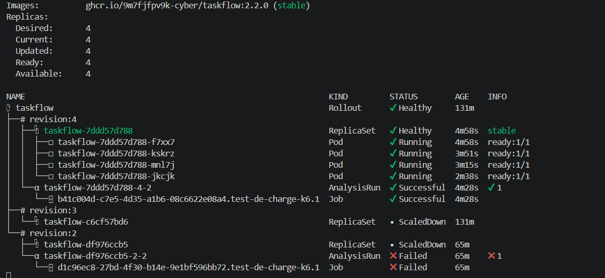

# Postmortem · Incident TaskFlow 2.1.0

| | |
|---|---|
| **Date de l'incident** | 15 octobre 2026 |
| **Rédigé par** | Binôme Hafsa HYVERNAT · Lorenzo SPERISEN · Lina Mebouga Messia |
| **Environnement** | Cluster kind `kind-cicd`, Argo CD, Argo Rollouts (stratégie Canary avec analyse k6) |
| **Gravité** | Mineure : détecté et annulé automatiquement en moins d'une minute d'exposition |
| **Statut** | Résolu : revert (PR #11), puis correctif 2.2.0 livré (PR #12) |

> **Postmortem sans reproche.** Ce document cherche ce qui a permis à l'erreur d'atteindre le cluster, pas qui l'a commise. Une PR qui ne change qu'un tag d'image ne permet pas, à la relecture, de deviner le comportement de cette image : c'est à la chaîne de livraison de le mesurer.

> **Heures.** Toutes les heures sont en heure de Paris (UTC+2). Kubernetes les affiche en UTC (suffixe `Z`) : nous avons ajouté 2 h.

---

## 1. Résumé

La version **2.1.0** de TaskFlow a été livrée par une Pull Request (PR #10) qui ne modifiait que le tag de l'image dans `apps/taskflow/rollout.yaml`. Argo CD l'a synchronisée et Argo Rollouts l'a déployée en **canary sur 25 % du trafic** (1 pod sur 4).

Le pod 2.1.0 est devenu **Ready : ses probes étaient vertes**. Pourtant, le test de charge k6 lancé automatiquement contre la nouvelle version seule a mesuré :

- **28,47 % d'erreurs** (84 requêtes sur 295), pour un seuil de 2 % ;
- un **p95 de 328,87 ms**, pour un seuil de 250 ms, contre 33,54 ms pour la version stable 2.0.0.

L'analyse a échoué et Argo Rollouts a **annulé le déploiement automatiquement**, sans aucune intervention humaine. Tout le trafic est revenu sur la 2.0.0.

| Indicateur | Valeur |
|---|---|
| Versions concernées | stable **2.0.0** · défectueuse **2.1.0** · corrective **2.2.0** |
| Part du trafic exposée | ≈ **25 %** (1 pod sur 4) |
| Durée d'exposition | ≈ **57 s** (12:19:45 → 12:20:42) |
| Requêtes en erreur estimées côté utilisateurs | ≈ **7 %** pendant 57 s (25 % du trafic × 28,47 % d'erreurs) |
| Requêtes ralenties | ≈ 25 % du trafic, + ≈ 300 ms chacune |
| Temps de détection (début du test → abort) | **37 s** |
| Merge → abort | **1 min 55 s** (12:18:47 → 12:20:42) |
| Abort → revert dans Git | **44 min 22 s** (12:20:42 → 13:05:04) |

Dans le cadre du lab, aucun utilisateur réel n'utilisait l'application : l'impact indiqué est celui qu'auraient subi des utilisateurs envoyant du trafic à ce moment-là.

---

## 2. Contexte : la chaîne de livraison

Depuis la PR #9 (`feat/analyse-auto`, mergée à 10:48:47), le Rollout `taskflow` suit cette stratégie :

| Étape | Contenu | Rôle |
|---|---|---|
| 1 | `setWeight: 25` | 1 pod sur 4 passe dans la nouvelle version |
| 2 | `pause: 20s` | Laisse le pod canary démarrer |
| 3 | `analysis` → `robustesse-k6` | **Porte de qualité** : Job k6 (5 utilisateurs, 30 s) contre `taskflow-canary` |
| 4 à 7 | 50 % → pause → 75 % → pause | Exécutées seulement si l'analyse réussit |

Seuils du test (`configmap-k6.yaml`) : `http_req_failed < 2 %` et `p(95) < 250 ms`. L'AnalysisTemplate utilise `failureLimit: 0` : un seul passage de k6 en échec suffit à faire échouer l'analyse.

Le service `taskflow-canary` ne vise que les pods de la nouvelle version. Via le service principal, 75 % des requêtes seraient allées vers la 2.0.0 saine, et le taux d'erreur de la 2.1.0 serait apparu dilué à environ 7 %.

### Étalon de la version stable (mesuré à 11:38)

```bash
./scripts/charge.sh http://taskflow
```

| Mesure | 2.0.0 |
|---|---|
| Requêtes (30 s) | 671 |
| `http_req_failed` | 0,00 % ✓ |
| `p(95)` | 33,54 ms ✓ |
| Moyenne / médiane / min | 21,34 ms / 10,96 ms / 3,04 ms |

Cet étalon montre que les seuils sont réalistes : la version stable les respecte avec une marge d'environ ×7 sur le p95.

---

## 3. Chronologie

Sources : historique Git (`git log`) et événements Kubernetes (`kubectl get events`, preuve 4).

### L'incident

| Heure | Événement | Source |
|---|---|---|
| 12:04:29 | Commit `0d33d8b` « déploiement de l'image TaskFlow 2.1.0 » | Git |
| **12:18:47** | **Merge de la PR #10** (`396de74`), après relecture et checks verts | Git / GitHub |
| 12:19:34 | Argo CD synchronise : révision 2 créée, ReplicaSet stable réduit de 4 à 3, ReplicaSet `taskflow-df976ccb5` (2.1.0) porté de 0 à 1 | events |
| 12:19:37 | Conteneur 2.1.0 démarré | events |
| 12:19:39 | `Readiness probe failed: GET /health … connection refused`, échec normal au démarrage (serveur pas encore à l'écoute) | events |
| **12:19:45** | **Palier 25 % atteint**, pod 2.1.0 Ready. `taskflow-canary` repointé vers la 2.1.0. Pause de 20 s. **Début de l'exposition.** | events |
| 12:20:05 | Fin de la pause, **AnalysisRun `taskflow-df976ccb5-2-2` lancée**, Job k6 créé | events / AnalysisRun |
| 12:20:37 | k6 : `thresholds on metrics 'http_req_duration, http_req_failed' have been crossed` | logs du Job |
| 12:20:41 | Job k6 en échec (`BackoffLimitExceeded`) | events |
| **12:20:42** | **AnalysisRun Failed, Rollout aborted.** Canary réduit à 0, stable remonté à 4, `taskflow-canary` repointé vers la 2.0.0. **Fin de l'exposition.** | events |
| 12:20:43 | Nouveau pod 2.0.0 démarré, retour à 4 pods stables | events |

**Aucune action humaine n'a eu lieu entre le merge (12:18:47) et l'abort (12:20:42).**

### Retour à un état cohérent

| Heure | Événement | Source |
|---|---|---|
| après 12:20:42 | Argo CD : **Synced + Degraded**. Le cluster sert la 2.0.0, mais Git demande toujours la 2.1.0. | `kubectl get application` |
| 13:02:55 | Commit `c520fa3`, `Revert "déploiement de l'image TaskFlow 2.1.0"`, créé par le bouton Revert de la PR #10 | Git |
| **13:05:04** | **Merge de la PR #11** (`4bfb7a5`). Git revient en 2.0.0. Le Rollout repasse **Healthy** sans recréer de pod (même ReplicaSet `c6cf57bd6`, renuméroté en révision 3). | Git / Rollout |

### Livraison du correctif

Les heures marquées ≈ sont déduites des âges affichés par `kubectl argo rollouts get rollout`.

| Heure | Événement | Source |
|---|---|---|
| **13:20** | **Merge de la PR #12** (image 2.2.0) | GitHub |
| ≈ 13:21:00 | Palier 25 % : 1 pod 2.2.0 (révision 4) | Rollout |
| ≈ 13:21:30 | AnalysisRun `taskflow-7ddd57d788-4-2` lancée, puis **Successful** | Rollout |
| ≈ 13:22:10 | Palier 50 %, **sans promote humain** | Rollout |
| ≈ 13:22:45 | Palier 75 % | Rollout |
| ≈ 13:23:20 | Palier 100 % : 2.2.0 stable, 4 pods, **Healthy** | Rollout |

---

## 4. Cause racine

### 4.1 Le composant défaillant : l'image `taskflow:2.1.0`

**Preuve :** la PR #10 ne change qu'une seule ligne, le tag de l'image. Même manifest, même cluster, même script k6 et mêmes seuils pour les trois versions. Seule la version de l'application varie :

| Mesure (k6, 5 VUs, 30 s) | Étalon 2.0.0 | **Incident 2.1.0** | Correctif 2.2.0 | Seuil |
|---|---|---|---|---|
| `http_req_failed` | 0,00 % | **28,47 %** ✗ | 0,00 % ✓ | < 2 % |
| `p(95)` | 33,54 ms | **328,87 ms** ✗ | 34,02 ms ✓ | < 250 ms |
| Minimum | 3,04 ms | **298,32 ms** | 2,64 ms | — |
| Médiane | 10,96 ms | **307,9 ms** | 9,77 ms | — |
| Requêtes en 30 s | 671 | **295** | 701 | — |

**Analyse des mesures de la 2.1.0 :**

- **Deux défauts distincts**, chacun suffisant pour échouer : environ 28 % des réponses ne sont pas des 200 (check `statut 200` : 211 réussis, 84 en échec), et toutes les requêtes sont lentes.
- **La lenteur est systématique, pas occasionnelle.** Le minimum (298 ms), la médiane (308 ms) et le p95 (329 ms) sont groupés : chaque requête subit un délai supplémentaire d'environ 300 ms. Même les réponses réussies sont lentes (p95 des réponses attendues : 330,91 ms).
- **Ce n'est pas un problème de capacité.** Même la requête la plus rapide prend 298 ms. Le défaut est dans le code de la version, pas dans la charge appliquée. La baisse du nombre de requêtes (295 contre 671) n'est qu'une conséquence de cette lenteur, puisque chaque utilisateur virtuel attend sa réponse avant la suivante.
- **La 2.2.0 confirme le diagnostic** : avec le même test sur un seul pod, elle revient au niveau de l'étalon (0 % d'erreurs, p95 = 34,02 ms).

### 4.2 Pourquoi les probes étaient-elles vertes ?

Les événements montrent que la **readiness probe** interroge `GET /health` sur le port 8000 :

```text
Readiness probe failed: Get "http://10.244.0.19:8000/health": dial tcp 10.244.0.19:8000: connect: connection refused
```

Cet échec n'apparaît qu'au démarrage du conteneur. Le même message est émis pour le pod 2.0.0 recréé à 12:20:43, ce n'est donc pas un symptôme de la 2.1.0. Dès que le serveur écoute, `/health` répond 200 et le pod devient **Ready**.

La probe vérifie que **le processus est vivant et répond sur sa route de santé**. Elle ne mesure ni le **taux d'erreur** ni la **latence** des **routes métier** que testait k6. Le pod 2.1.0 était donc considéré comme prêt alors qu'il échouait environ une requête sur quatre et ajoutait environ 300 ms à chacune.

> Une probe répond à la question « le conteneur doit-il recevoir du trafic ? ». Elle ne répond pas à « la version fonctionne-t-elle correctement pour les utilisateurs ? ». Seule une mesure du comportement réel, sous charge, peut répondre à la seconde question.

### 4.3 Ce qui a laissé passer l'erreur jusqu'au cluster

1. **La relecture de la PR ne pouvait pas détecter le défaut.** Le diff ne contient qu'un changement de tag (`2.0.0` → `2.1.0`). Le comportement de l'image est invisible dans un manifest.
2. **Aucun test de performance n'existe avant le merge.** Les checks de la CI (Jour 1) valident le code, pas le comportement de l'image sous charge.
3. **Les probes sont trop superficielles pour juger une version** (voir 4.2), et c'est normal : ce n'est pas leur rôle.

**Le premier contrôle capable de voir le défaut était l'analyse k6 pendant le canary.** C'est elle qui a arrêté la version.

---

## 5. Ce qui a bien fonctionné

- **Détection et annulation 100 % automatiques.** L'analyse k6 a conclu en 37 s, et l'abort a eu lieu dans la même seconde que l'échec de l'analyse. Aucun humain n'a eu à surveiller ou à décider.
- **Rayon d'impact limité dans l'espace.** Le canary n'a exposé qu'environ 25 % du trafic. Avec une stratégie Recreate ou un rolling update, 100 % des utilisateurs auraient fini par subir les erreurs.
- **Rayon d'impact limité dans le temps.** L'exposition a duré environ 57 s.
- **Mesure de la nouvelle version seule.** Grâce au service `taskflow-canary`, k6 a mesuré 28,47 % d'erreurs et non une valeur diluée d'environ 7 %.
- **Retour arrière propre.** Le revert (PR #11) a été relu et tracé. Il n'a recréé aucun pod, puisque la version demandée était déjà la version stable en service.
- **Traçabilité complète.** Git dit qui a décidé quoi et quand (PR #10, #11, #12). Le Rollout conserve la révision 2, avec son AnalysisRun et son Job en échec, même après le retour à la normale.
- **Contre-épreuve réussie.** La même porte de qualité a laissé passer la 2.2.0 sans intervention. Le mécanisme mesure, il ne bloque pas aveuglément.

## 6. Ce qui a moins bien fonctionné

- **Exposition avant le test.** Pendant la pause de 20 s puis pendant les 37 s du test, les utilisateurs étaient déjà servis par la 2.1.0. Sans traffic router, le pod canary reçoit du trafic dès qu'il est Ready, avant d'avoir été testé.
- **Délai de 44 minutes entre l'abort et le revert.** Pendant ce temps, Git décrivait une version défectueuse comme état voulu (Argo CD Synced + Degraded). Une relance du Rollout ou un nouveau merge à partir de cette base aurait pu redéployer la 2.1.0.
- **Aucune notification.** L'abort n'a prévenu personne. Il a été constaté en regardant les terminaux.
- **L'outil de test enfreint notre propre politique de sécurité.** Le Job k6 utilise l'image `grafana/k6:latest`, contraire aux règles R1 (tag explicite, jamais `latest`) et R2 (registre `ghcr.io/9m7fjfpv9k-cyber/` uniquement) de la mini-PSSI.

---

## 7. Actions

| # | Date et heure | Action | Résultat | Responsable |
|---|---|---|---|---|
| 1 | 15/10/2026 10:48:47 | Merge de la PR #9 `feat/analyse-auto` : ajout de l'AnalysisTemplate k6, de la ConfigMap et du service `taskflow-canary` | Analyse automatique branchée après le palier 25 % | Trinome |
| 2 | 15/10/2026 11:16 | Création de l'Application Argo CD sur le cluster local (`kubectl apply -f argocd/application.yaml`) | Application Synced + Healthy, cluster aligné sur Git | Trinome |
| 3 | 15/10/2026 ≈ 11:32 | Correction des fins de ligne Windows (CRLF) des scripts (`git config core.autocrlf input`, `sed`) | Scripts exécutables sous WSL | Trinome |
| 4 | 15/10/2026 11:38 | Mesure de l'étalon de la 2.0.0 (`charge.sh`, k6 5 VUs 30 s) | 0,00 % d'erreurs, p95 = 33,54 ms, seuils ✓ | Trinome |
| 5 | 15/10/2026 12:18:47 | Merge de la PR #10 : livraison de la 2.1.0 | Canary 25 % à 12:19:45 | Trinome |
| 6 | 15/10/2026 12:20:05 | Lancement de l'analyse k6 sur `taskflow-canary` | 28,47 % d'erreurs, p95 = 328,87 ms, seuils ✗ | Automatique (Argo Rollouts) |
| 7 | 15/10/2026 12:20:42 | **Abort automatique** du Rollout | Trafic 100 % sur la 2.0.0, exposition stoppée après ≈ 57 s | Automatique (Argo Rollouts) |
| 8 | 15/10/2026 12:28 → 12:55 | Enquête : collecte des 4 preuves (Rollout, AnalysisRun, logs k6, événements horodatés) | Cause racine identifiée : image 2.1.0 | Trinome |
| 9 | 15/10/2026 13:05:04 | Merge de la PR #11 : **revert** de la 2.1.0 | Git remis en 2.0.0, Rollout Healthy sans nouveau pod | Trinome |
| 10 | 15/10/2026 13:20 | Merge de la PR #12 : livraison du correctif 2.2.0 | Canary 25 % puis analyse k6 | Trinome |
| 11 | 15/10/2026 ≈ 13:21:30 | Analyse k6 de la 2.2.0 | 0,00 % d'erreurs, p95 = 34,02 ms, seuils ✓ | Automatique (Argo Rollouts) |
| 12 | 15/10/2026 ≈ 13:23:20 | Promotion automatique à 100 % | 2.2.0 stable, 4 pods, Healthy | Automatique (Argo Rollouts) |
| 13 | 15/10/2026 13:34 | Collecte des preuves de la 2.2.0 (logs k6) | Comparaison 2.0.0 / 2.1.0 / 2.2.0 complète | Trinome |
| 14 | 15/10/2026 ≈ 14:00 | Rédaction du postmortem | `docs/postmortem-2.1.0.md` | Trinome |

> **Action écartée :** rendre la readiness probe « plus profonde » (par exemple en lui faisant tester les routes métier ou la base de données). Si une dépendance tombait, tous les pods deviendraient non-Ready en même temps et le service tomberait entièrement. Le comportement réel se mesure avec l'analyse et le monitoring, pas avec les probes.


### Actions d'amélioration

| # | Action | Objectif | Responsable | Échéance |
|---|---|---|---|---|
| 1 | Test de charge k6 dans la CI sur les PR qui modifient l'image | Détecter le défaut avant le merge | Trinome | 16/10/2026 |
| 2 | Notifications Argo Rollouts sur `RolloutAborted` | Prévenir l'équipe dès un abort | Trinome | 16/10/2026 |
| 3 | Procédure « abort puis revert par PR » avec délai cible < 15 min | Réduire les 44 min d'écart entre Git et le cluster | Trinome | 16/10/2026 |
---

## 8. Preuves

### Captures

**Le canary 2.1.0 annulé automatiquement (12:28)**  
Révision 2 : ReplicaSet `ScaledDown`, AnalysisRun et Job `Failed`, Rollout `Degraded`, 2.0.0 stable.



**Résumé k6 de l'analyse en échec (2.1.0)**



**Après le revert (PR #11)**  
Rollout `Healthy`, mêmes pods (révision 3), trace de la révision 2 conservée.



**Analyse 2.2.0 réussie, progression automatique (palier 75 %)**



**Canary 2.2.0 promu à 100 % sans intervention**



### Fichiers de preuves (`docs/preuves/`)

| Fichier | Contenu | Commande |
|---|---|---|
| `etalon-2.0.0.txt` | Étalon k6 de la 2.0.0 | `./scripts/charge.sh http://taskflow` |
| `1-rollout.txt` | État du Rollout après l'abort | `kubectl argo rollouts get rollout taskflow -n taskflow` |
| `1-argocd.txt` | Argo CD : Synced + Degraded | `kubectl get application -n argocd` |
| `2-analysisrun-liste.txt` | Liste des AnalysisRun | `kubectl -n taskflow get analysisrun` |
| `2-analysisrun-detail.txt` | Métrique en échec, `failureLimit (0)` | `kubectl -n taskflow describe analysisrun taskflow-df976ccb5-2-2` |
| `3-k6.txt` | Mesures k6 de la 2.1.0 | `kubectl -n taskflow logs job/<job-2.1.0>` |
| `4-events.txt` | Événements (heures relatives) | `kubectl -n taskflow get events --sort-by=.lastTimestamp` |
| `4-events-horodates.txt` | Événements (heures exactes UTC) | idem avec `-o custom-columns=…` |
| `5-k6-2.2.0.txt` | Mesures k6 de la 2.2.0 | `kubectl -n taskflow logs job/<job-2.2.0>` |

### Extraits clés

Décision de l'analyse (`2-analysisrun-detail.txt`) :

```text
Message:  Metric "test-de-charge-k6" assessed Failed due to failed (1) > failureLimit (0)
Started At:  2026-10-15T10:20:05Z
Completed At:  2026-10-15T10:20:42Z
```

Abort automatique (`4-events-horodates.txt`) :

```text
2026-10-15T10:20:42Z   RolloutAborted   taskflow   Rollout aborted update to revision 2: Step-based analysis phase error/failed: Metric "test-de-charge-k6" assessed Failed due to failed (1) > failureLimit (0)
```

Seuils franchis (`3-k6.txt`) :

```text
http_req_duration
✗ 'p(95)<250' p(95)=328.87ms
http_req_failed
✗ 'rate<0.02' rate=28.47%
```

Historique Git :

```text
2026-10-15 13:05:04 +0200 | 4bfb7a5 | Merge pull request #11 (revert)
2026-10-15 13:02:55 +0200 | c520fa3 | Revert "déploiement de l_image TaskFlow 2.1.0"
2026-10-15 12:18:47 +0200 | 396de74 | Merge pull request #10 (2.1.0)
2026-10-15 12:04:29 +0200 | 0d33d8b | déploiement de l_image TaskFlow 2.1.0
2026-10-15 10:48:47 +0200 | a34c8e3 | Merge pull request #9 (feat/analyse-auto)
```

---

## 9. En une phrase

La 2.1.0 avait des probes vertes mais échouait environ une requête sur quatre avec 300 ms de latence supplémentaire. La chaîne l'a détectée par un test de charge sur la nouvelle version seule et l'a annulée sans humain en moins d'une minute d'exposition. Le revert par PR a remis Git en accord avec la réalité, puis la 2.2.0 est passée par la même porte et a été promue automatiquement.
